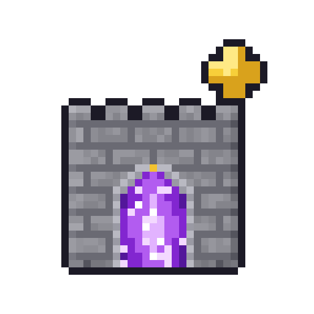

<p align="center">
  
</p>

# GatesPlus

Bouw poorten van (bijna) elk blok. Een poort gaat **vloeiend open en dicht met redstone**: zet een hendel, knop of drukplaat op het trigger-blok en de poort schuift rij per rij open. Poorten kunnen onbreekbaar en vuurvast zijn, je kunt ze delen met een groep, en je betaalt ze met echte blokken uit je inventory.

---

## Inhoud

1. [Vereisten](#vereisten)
2. [Installatie](#installatie)
3. [Snel aan de slag](#snel-aan-de-slag)
4. [De selectiebijl en markerblokken](#de-selectiebijl-en-markerblokken)
5. [Commando's](#commandos)
6. [Hoe een poort werkt](#hoe-een-poort-werkt)
7. [Blokken betalen en terugkrijgen](#blokken-betalen-en-terugkrijgen)
8. [Kapot, onvolledig en herstellen](#kapot-onvolledig-en-herstellen)
9. [Bescherming: onbreekbaar en vuurvast](#bescherming-onbreekbaar-en-vuurvast)
10. [Groepen](#groepen)
11. [Info-venster en dev-modus](#info-venster-en-dev-modus)
12. [Rechten (permissions)](#rechten-permissions)
13. [Configuratie](#configuratie)
14. [Opslag: SQLite of MySQL](#opslag-sqlite-of-mysql)
15. [Talen en meldingen aanpassen](#talen-en-meldingen-aanpassen)
16. [Veelgestelde vragen](#veelgestelde-vragen)

---

## Vereisten

| | Versie |
|---|---|
| Minecraft | **26.3** |
| Fabric Loader | 0.20.1 of nieuwer |
| [Fabric API](https://modrinth.com/mod/fabric-api) | voor 26.3 |
| Java | 25 |

> **De mod is nodig op de server én bij elke speler.** GatesPlus voegt eigen blokken toe (de markerblokken), dus spelers zonder de mod kunnen niet joinen.

SQLite, MySQL, YAML en de LuckPerms-koppeling zitten al in de jar; je hoeft niets extra te installeren.

## Installatie

1. Installeer Fabric Loader voor Minecraft 26.3.
2. Zet `gatesplus-<versie>.jar` en Fabric API in de `mods`-map (op de server **en** bij elke speler).
3. Start de server. Bij de eerste start wordt `config/gatesplus/` aangemaakt met:
   - `config.yml` – alle instellingen (met uitleg erbij),
   - `gatesplus.db` – de database (bij SQLite),
   - `lang/nl.yml` en `lang/en.yml` – alle meldingen.

## Snel aan de slag

```
/gp create                    start een nieuwe poort, je krijgt de selectiebijl
  linkerklik                  hoek 1 (linksboven)
  linkerklik                  hoek 2 (rechtsonder)
/gp set block stone_bricks    kies het blok (optioneel, standaard dirt)
/gp set trigger               de bijl kiest nu het trigger-blok
  linkerklik                  op het blok dat de poort bedient
/gp confirm voordeur          bouw de poort
```

Zet nu een hendel op (of naast) het trigger-blok. Hendel aan = poort open, hendel uit = poort dicht.

## De selectiebijl en markerblokken

Tijdens `/gp create` of `/gp edit` heb je een gloeiende **houten bijl** (de selectiebijl).

| Actie | Wat er gebeurt |
|---|---|
| **Linkerklik** op een blok | Zet een hoek op het **luchtblok vóór** het vlak waarop je klikt. Eerste klik = hoek 1, tweede = hoek 2, daarna verplaats je hoek 2. |
| **Linkerklik** op een markerblok | Zet de hoek **op het markerblok zelf** (zie hieronder). |
| **Rechterklik** | Haalt het laatst gezette punt weg: eerst het trigger-blok, dan hoek 2, dan hoek 1. |
| **Linkerklik** in trigger-modus | Kiest het trigger-blok (na `/gp set trigger`). |

Je ziet je selectie meteen: hoek 1 **goud**, hoek 2 **rood**, de rand van de poort **groen**, het trigger-blok **blauw** (pulserend). Blokken die het bouwen tegenhouden, worden **rood** gemarkeerd.

### Markerblokken

Om een hoek midden in de lucht te zetten gebruik je markerblokken:

```
/gp get markerblock
```

Je krijgt er twee: een **gouden "1"** (linksboven, hoek 1) en een **rode "2"** (rechtsonder, hoek 2). Plaats ze waar de hoeken moeten komen en klik erop met de bijl; elk blok zet altijd zijn eigen hoek, in welke volgorde je ook klikt.

- Markerblokken krijg je **alleen tijdens een sessie** (`/gp create` of `/gp edit`).
- Markers ín de poort verdwijnen vanzelf als de poort gebouwd wordt.
- Als de sessie stopt, verdwijnen ongebruikte markers uit je inventory en geplaatste markers uit de wereld.
- Markers breken in één klik en laten niets vallen.

### De bijl en markers zijn vergrendeld

Je kunt de bijl en markerblokken niet droppen, niet in een kist of hopper steken en niet aan een item frame geven. Ze verdwijnen vanzelf bij `/gp confirm`, `/gp cancel`, bij uitloggen, als je doodgaat, of na de **sessie-timeout** (standaard 10 minuten zonder activiteit).

## Commando's

`/gp` en `/gatesplus` zijn hetzelfde. `/gp help` toont een kort overzicht.

### Poorten maken en aanpassen

| Commando | Uitleg |
|---|---|
| `/gp create` | Start een nieuwe poort (je krijgt de bijl). |
| `/gp edit <id\|naam>` | Start een bewerk-sessie voor een bestaande poort; alles wat je met `/gp set` aanpast, wordt pas opgeslagen bij `/gp confirm`. |
| `/gp confirm <naam>` | Bouwt de poort (bij `/gp edit`: `/gp confirm` of `/gp confirm <nieuwe naam>`). |
| `/gp cancel` | Stopt de sessie zonder iets te veranderen. |
| `/gp get markerblock` | Geeft de twee markerblokken (alleen in een sessie). |

### Instellingen (tijdens `/gp create` of `/gp edit`)

| Commando | Uitleg |
|---|---|
| `/gp set block <blok>` | Het blok van de poort, bv. `stone` of `minecraft:oak_planks`. Zie `/gp list blocks`. |
| `/gp set trigger` | Laat de bijl het trigger-blok kiezen (pas na beide hoeken). |
| `/gp set direction vertical` | Animatie van onder naar boven (standaard). |
| `/gp set direction horizontal` | Animatie van links naar rechts. |
| `/gp set animation enabled\|disabled` | Animatie aan of uit voor deze poort. |
| `/gp set redstone normal\|inverted` | `inverted`: de poort is open **zonder** stroom. |
| `/gp set indestructible on\|off` | Onbreekbaar of breekbaar. |
| `/gp set fireproof on\|off` | Vuurvast of brandbaar. |
| `/gp set group <groep\|none>` | Hang de poort aan een groep, of maak ze weer persoonlijk. |

### Overzicht en beheer

| Commando | Uitleg |
|---|---|
| `/gp list` | Jouw poorten en die van je groepen. Naam **groen** = werkt, **rood** = kapot/onvolledig/trigger weg. |
| `/gp list blocks` | Blokken waarvan je een poort mag maken. |
| `/gp list all` | Alle poorten op de server, met eigenaar (admin). |
| `/gp info <id\|naam>` | Alle details van een poort. |
| `/gp repair [id\|naam]` | Vult ontbrekende blokken aan uit je inventory. Zonder naam: de poort die je nu bewerkt. |
| `/gp remove <id\|naam>` | Verwijdert de poort; je krijgt je betaalde blokken terug. |
| `/gp reload` | Herlaadt `config.yml` en de taalbestanden (admin). |
| `/gp devstats` | Zet de dev-modus aan/uit (admin), zie [hieronder](#info-venster-en-dev-modus). |

### Groepen

| Commando | Uitleg |
|---|---|
| `/gp group create <groep>` | Maakt een groep; jij bent de eigenaar. |
| `/gp group delete <groep>` | Verwijdert de groep; de poorten worden weer persoonlijk van hun eigenaar. |
| `/gp group add <groep> <speler>` | Voegt een (online) speler toe. |
| `/gp group remove <groep> <speler>` | Haalt een lid uit de groep. |
| `/gp group list` | Groepen waar je in zit. |
| `/gp group members <groep>` | Leden van een groep (online/offline). |
| `/gp group gates <groep>` | Poorten van een groep. |
| `/gp group info <groep>` | Leden en poorten in één overzicht. |

### Namen en id's

Elke poort heeft een **id** dat uniek is op de hele server (`#12`) en een **naam** die uniek is binnen jouw eigen poorten of binnen een groep. Overal waar `<id|naam>` staat, mag je ook `groep:naam` gebruiken als dezelfde naam in meerdere groepen voorkomt.

## Hoe een poort werkt

- **Alleen in lucht.** Een poort wordt alleen gebouwd waar lucht is (en markerblokken). Staat er iets in de weg, dan weigert `/gp confirm` en zie je de blokken in het rood. GatesPlus vervangt of verwijdert nooit bestaande blokken, dus je kunt er niet mee minen.
- **Vorm.** Elke rechthoekige doos: een muur, een vloer (valluik) of een dik blok, binnen de limieten uit de config.
- **Trigger-blok.** Precies één per poort, maximaal `max-trigger-distance` blokken (standaard 5) van de poort. Het mag een gewoon blok zijn waar je een hendel op zet, of zelf een hendel, knop of drukplaat.
- **Standaard dicht.** Zonder stroom op de trigger is de poort dicht; met stroom gaat ze open (of omgekeerd met `/gp set redstone inverted`).
- **Niemand wordt ingesloten.** Staat er een speler, dier of item in de opening, dan wacht de poort met sluiten. Ze sluit ook niet over blokken die iemand in de opening heeft gezet; de eigenaar krijgt dan één melding.
- **Animatie.** Rij per rij: de volgende rij begint pas als de vorige klaar is.
  - Openen (verticaal): van onder naar boven, elke rij trekt zich omhoog terug.
  - Sluiten (verticaal): van boven naar beneden, iets trager dan openen; elke rij wordt een echt blok zodra ze klaar is.
  - Horizontaal: van links naar rechts.
  - De totale duur stel je in met `animation-ticks` (20 ticks = 1 seconde). Een server-admin kan animaties volledig uitzetten; dan kan niemand ze aanzetten.
- **Trigger vernietigd.** De poort gaat open. Zet je er weer een blok neer, dan werkt ze meteen opnieuw.
- **Zand en grind** blijven gewoon hangen als ze deel zijn van een poort.
- **Poorten aanpassen** kan altijd met `/gp edit`. Een groter of kleiner gat, ander blok of andere trigger: de poort wordt netjes opnieuw gebouwd en je betaalt/krijgt het verschil.

## Blokken betalen en terugkrijgen

Met `require-blocks: true` (standaard) kost een poort echte blokken:

- **Bouwen** haalt de blokken uit je inventory. Heb je er te weinig, dan wordt het deel gebouwd dat je hebt (van onder naar boven) en is de poort **onvolledig**: ze werkt pas als ze af is (`/gp repair`).
- **Verwijderen** geeft de **betaalde** blokken terug. Meer dan 60 blokken (`chest-threshold`)? Dan komen ze in een gewone kist naast je, die vanzelf verdwijnt zodra ze leeg is. Breek je de kist, dan valt de inhoud er gewoon uit.
- **Creative:** met `creative-free: true` (standaard) bouw je in creative gratis en krijg je bij verwijderen dus ook **niets** terug.
- Met `require-blocks: false` is alles gratis.

## Kapot, onvolledig en herstellen

| Status | Betekenis | Wat te doen |
|---|---|---|
| **OK** | De poort werkt. | – |
| **Onvolledig** | Nog niet alle blokken betaald. Het betaalde deel staat er, de poort werkt niet. | `/gp repair` |
| **Kapot** | Er is een poortblok weg (gebroken, explosie, vuur, piston, ...). De poort blijft **staan zoals ze is**, met het gat, en reageert niet meer op redstone. | `/gp repair`, of zet zelf het juiste blok in het gat. |
| **Trigger ontbreekt** | Het trigger-blok is weg; de poort staat open. | Zet er een blok terug, of kies een nieuw met `/gp edit`. |

`/gp repair` vult de gaten van onder naar boven met blokken uit je inventory. Heb je er te weinig, dan wordt wat je hebt geplaatst en zie je hoeveel er nog ontbreken (`12 / 16`). Zodra alles er weer staat, werkt de poort meteen.

## Bescherming: onbreekbaar en vuurvast

Beide staan standaard aan en zijn per poort te wijzigen (`/gp set indestructible`, `/gp set fireproof`).

- **Onbreekbaar:** spelers, explosies en pistons kunnen de poortblokken niet breken of verschuiven. Admins kunnen dit in creative toelaten (`allow-op-break`).
- **Vuurvast:** de blokken branden niet op, er kan geen vuur tegen de poort branden (aansteken lukt niet, bestaand vuur dooft vanzelf) en brandende blokken ernaast verspreiden het vuur niet tot tegen de poort.
- Het **trigger-blok** is bewust niet beschermd.

## Groepen

Met een groep deel je poorten met andere spelers.

- **Leden** mogen poorten van de groep bewerken (`/gp edit`) en herstellen, maar **niet verwijderen**.
- Alleen de **eigenaar van de poort** (of een admin) mag ze verwijderen; alleen de **eigenaar van de groep** beheert de leden.
- Een poortnaam moet uniek zijn binnen de groep; dezelfde naam mag wel als persoonlijke poort bestaan.

## Info-venster en dev-modus

Tijdens `/gp create` en `/gp edit` toont een **venster rechtsboven** alles over de poort waaraan je werkt: naam en id, blok, trigger-blok, hoeken en grootte, blokken (`12 / 16`, en hoeveel je bij je hebt), status, bescherming, animatie, redstone en groep/eigenaar. Alles wordt meteen bijgewerkt.

**Dev-modus** (`/gp devstats`, admin) toont een tweede venster met live serverstatistieken: aantal poorten (geladen/actief/kapot), tijd per tick, controles per seconde, animaties, sessies, database-wachtrij en fouten. In dev-modus krijg je ook extra meldingen, zoals "poort is onbreekbaar" en "poort is kapot". Nogmaals `/gp devstats` zet het weer uit.

## Rechten (permissions)

GatesPlus werkt met [LuckPerms](https://luckperms.net/) (via fabric-permissions-api). Zonder permissie-plugin gelden de standaardwaarden.

| Permissie | Standaard | Geeft toegang tot |
|---|---|---|
| `gatesplus.use` | iedereen | create, edit, confirm, cancel, set, list, info, repair |
| `gatesplus.remove` | iedereen | eigen poorten verwijderen |
| `gatesplus.group` | iedereen | `/gp group ...` |
| `gatesplus.get.marker` | iedereen | `/gp get markerblock` |
| `gatesplus.set.animation` | iedereen | `/gp set animation` |
| `gatesplus.set.inverted` | iedereen | `/gp set redstone inverted` |
| `gatesplus.set.indestructible` | iedereen | `/gp set indestructible` |
| `gatesplus.set.fireproof` | iedereen | `/gp set fireproof` |
| `gatesplus.bypass.limits` | operator | limieten negeren (aantal, grootte) |
| `gatesplus.admin.edit` | operator | poorten van anderen bekijken/bewerken, `/gp list all` |
| `gatesplus.admin.remove` | operator | poorten van anderen verwijderen |
| `gatesplus.admin.break` | operator | onbreekbare poorten breken in creative (met `allow-op-break`) |
| `gatesplus.admin.reload` | operator | `/gp reload` |
| `gatesplus.admin.devstats` | operator | `/gp devstats` |

## Configuratie

Alles staat in `config/gatesplus/config.yml`. Na een wijziging: `/gp reload` (behalve `storage`, daarvoor moet de server herstarten).

```yaml
language: nl                 # nl | en | auto (volgt de taal van elke speler)

storage:
  type: sqlite               # sqlite | mysql
  sqlite: { file: gatesplus.db }
  mysql: { host: localhost, port: 3306, database: gatesplus, user: root, password: "", pool-size: 4 }

limits:
  max-gates-per-player: 5
  max-gate-blocks: 256       # maximaal aantal blokken per poort
  max-width: 16
  max-height: 16
  max-depth: 4
  max-trigger-distance: 5    # afstand trigger-blok <-> poort
  max-groups-per-player: 5
  max-members-per-group: 20
  max-concurrent-animations: 50

allowed-blocks:              # blokken waarvan je een poort mag maken
  - minecraft:dirt
  - minecraft:stone
  # ...
non-full-block-whitelist:    # niet-volle blokken die toch mogen (tralies, ruiten, hekken)
  - minecraft:iron_bars

session:
  timeout-minutes: 10

defaults:                    # standaardwaarden voor een nieuwe poort
  block: minecraft:dirt
  indestructible: true
  fireproof: true
  animation-enabled: true
  direction: vertical        # vertical | horizontal
  animation-ticks: 20        # totale duur van de animatie (20 = 1 seconde)

animation:
  enabled: true              # false = geen enkele poort animeert, niemand kan het aanzetten
  allow-player-toggle: true

redstone:
  check-interval-ticks: 4
  allow-inverted: true

protection:
  allow-op-break: false

materials:
  require-blocks: true
  creative-free: true
  return-on-remove: true
  chest-threshold: 60
```

**Toegestane blokken.** Blokken die niet stabiel kunnen blijven, worden automatisch geweigerd (met een waarschuwing in de serverlog), ook als ze in `allowed-blocks` staan: kisten en andere blokken met inhoud, vloeistoffen, fakkels/bloemen/knoppen, deuren en bedden, blokken die vanzelf veranderen (gras, bladeren, ijs, koper), TNT, redstone-onderdelen en de markerblokken. Zand en grind mogen wel; die worden vastgezet.

## Opslag: SQLite of MySQL

- **SQLite** (standaard): een bestand `config/gatesplus/gatesplus.db`, niets in te stellen.
- **MySQL**: zet `storage.type: mysql`, vul de gegevens in en herstart de server. De tabellen worden automatisch aangemaakt.

De database heeft een schemaversie; bij een update van de mod wordt ze automatisch bijgewerkt (bij SQLite wordt eerst een back-up gemaakt).

## Talen en meldingen aanpassen

Alle meldingen staan in `config/gatesplus/lang/nl.yml` en `en.yml`. Je mag de teksten aanpassen (`&a`, `&c`, ... zijn kleuren; `{0}`, `{1}` zijn waarden) en daarna `/gp reload` doen. Ontbrekende teksten vallen terug op de ingebouwde versie.

## Veelgestelde vragen

**Ik krijg mijn blokken niet terug bij `/gp remove`.**
Je bouwde de poort in creative. Met `creative-free: true` is dat gratis en dus krijg je ook niets terug. Zet `creative-free: false` als creative-spelers wel moeten betalen.

**`/gp list` is leeg, maar ik heb een poort gemaakt.**
De poort hoort bij een andere speler (bijvoorbeeld een andere account). Admins zien alle poorten met `/gp list all`.

**De poort gaat niet dicht.**
Er staat iets in de opening (speler, dier, item of een blok), de poort is kapot/onvolledig (naam is rood in `/gp list`), of de trigger krijgt nog stroom.

**Ik kan geen poort bouwen: "staat in de weg".**
Poorten worden alleen in lucht gebouwd. Haal de rood gemarkeerde blokken weg of gebruik markerblokken voor hoeken in de lucht.

## Licentie

Zie [LICENSE](LICENSE).
